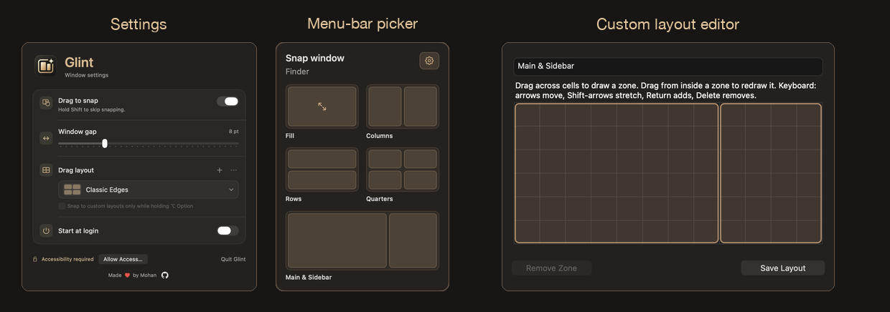

<p align="center">
  
</p>

<h1 align="center">Glint</h1>

<p align="center">Window snapping for macOS. Drag to a zone or choose one from the menu bar.</p>

<p align="center">
  <a href="#install">Install</a> ·
  <a href="#use-glint">Use Glint</a> ·
  <a href="#walkthrough">Watch the demo</a> ·
  <a href="#troubleshooting">Troubleshooting</a>
</p>



<p align="center">
  <a href="docs/media/settings.png">Settings</a> ·
  <a href="docs/media/menu-bar-picker.png">Menu-bar picker</a> ·
  <a href="docs/media/layout-editor.png">Layout editor</a>
</p>

## Install

Glint builds from source on **macOS 13 or later**. You’ll need Xcode Command Line Tools and GitHub access to this repository.

### 1. Build and open Glint

If the command-line tools are missing, run `xcode-select --install`. If you use GitHub CLI to authenticate Git over HTTPS, run `gh auth login` and `gh auth setup-git` before cloning.

```sh
git clone https://github.com/mohan-codebase/glint.git
cd glint
make
open build/Glint.app
```

To use Glint from **Applications**, quit it, move the built `Glint.app` there in Finder, and open that copy.

### 2. Allow window control

1. Open Glint Settings and click **Allow Access…**.
2. In **System Settings → Privacy & Security → Accessibility**, enable **Glint**. If it’s missing, click **+** and add the `Glint.app` you opened.
3. Return to Glint Settings and confirm it shows **Accessibility enabled**. [View Settings screenshot](docs/media/settings.png).

## Use Glint

### Drag to snap

1. Turn on **Drag to snap** in Settings and choose **Classic Edges** under **Drag layout**.
2. Grab a resizable window by its title bar and move it toward a display edge or corner.
3. Release when the preview shows where you want the window. Hold **Shift** during a drag to skip snapping.

### Pick a zone from the menu bar

1. Focus the window you want to move, then click the Glint icon in the menu bar.
2. Click a zone under **Fill**, **Columns**, **Rows**, or **Quarters**. Your selected custom layout appears beneath the presets.
3. Use the gear button to return to Settings. [View picker screenshot](docs/media/menu-bar-picker.png).

### Create a custom layout

1. In Settings, click **+** beside **Drag layout** and enter a name.
2. Drag across grid cells to draw a zone. Drag from inside an existing zone to redraw it, or select it and choose **Remove Zone**.
3. Click **Save Layout**. Glint selects the saved layout and adds its zones to the picker. Use **•••** beside **Drag layout** to edit or delete the selected layout. [View editor screenshot](docs/media/layout-editor.png).

With the grid focused, use the arrow keys to move, **Shift + arrows** to stretch, **Return** to add a zone, **Delete** to remove it, and **Command + Return** to save.

### Adjust your defaults

- **Window gap** controls the space around snapped windows in points.
- **Snap to custom layouts only while holding ⌥ Option** lets you freely move windows with a custom layout selected. Hold **Option** during a drag when you want to snap.
- **Start at login** opens Glint in the menu bar the next time you sign in. If macOS asks for approval, click **Open Login Items…** in Settings.

## Walkthrough

[](docs/media/glint-walkthrough.mp4)

[Watch or download the 32-second MP4](docs/media/glint-walkthrough.mp4)

## Troubleshooting

<details>
<summary>Glint keeps asking for Accessibility after I rebuild</summary>

Quit Glint, then open **System Settings → Privacy & Security → Accessibility**. Remove the stale Glint entry, add the current app bundle with **+**, and enable it. Relaunch the copy you just approved.

</details>

<details>
<summary>A window doesn’t fit the zone I picked</summary>

Check that the window is resizable and outside macOS full-screen mode. Some apps enforce a minimum window size. Try a larger zone or reduce **Window gap**.

</details>

## Tests

```sh
make test
```

The suite covers snap geometry, display coordinates, gaps, saved layout recovery, and placement for windows with minimum sizes.

---

<p align="center">Made ❤️ by <a href="https://github.com/mohan-codebase">Mohan</a></p>
