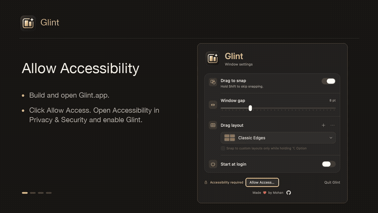
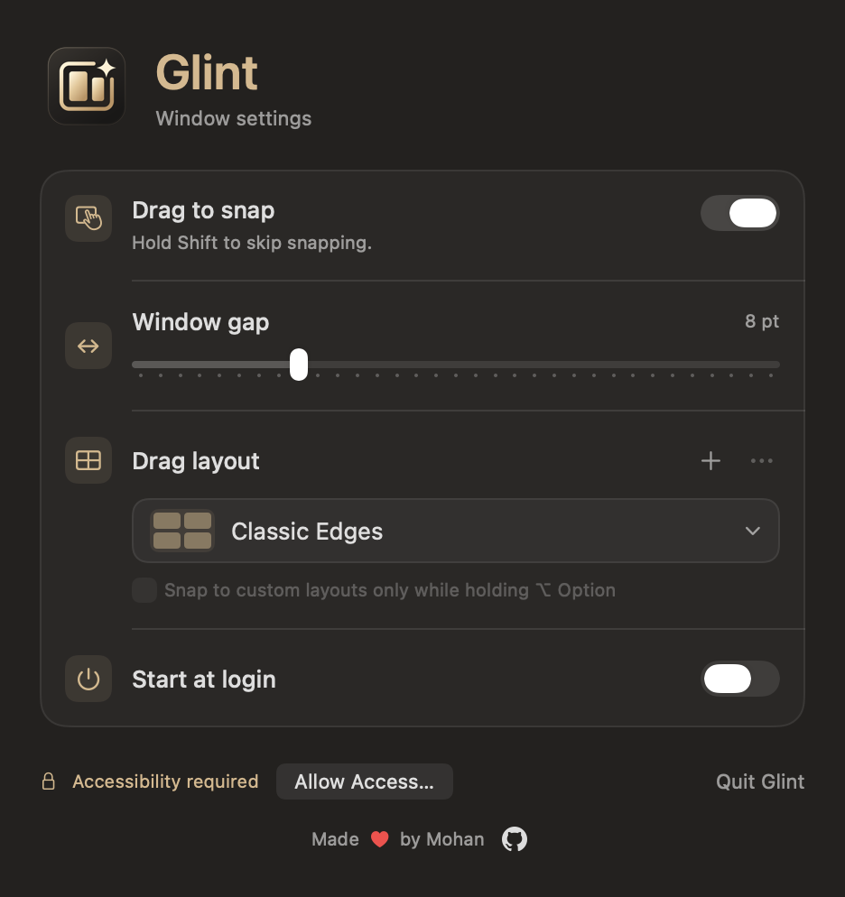
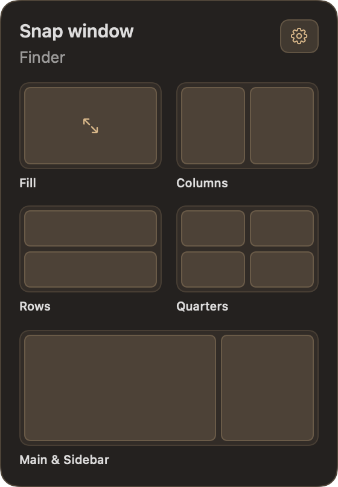
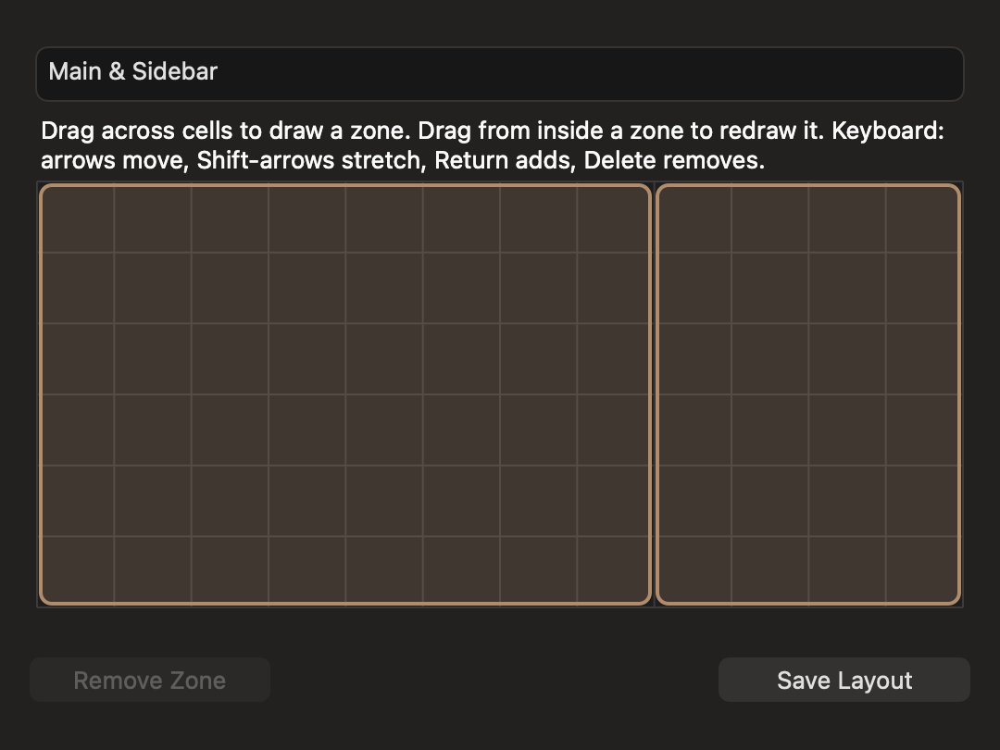

# Glint

Glint is a macOS menu-bar app for arranging windows. Drag a window into a snap zone, or click a tile in the menu-bar picker. Set your own gaps and layouts, and choose whether Glint starts at login.

[Install from source](#install-from-source) · [Watch the walkthrough](#watch-the-walkthrough) · [Create a custom layout](#create-a-custom-layout)

## Watch the walkthrough

[](docs/media/glint-walkthrough.mp4)

[Watch or download the 32-second MP4](docs/media/glint-walkthrough.mp4). The walkthrough has on-screen instructions and uses example layouts.

## Install from source

1. Use **macOS 13 or later** with Xcode Command Line Tools. If they’re missing, run `xcode-select --install` in Terminal and finish the installer.
2. Sign in to GitHub with an account that has access to this private repository. Use an authenticated Git setup for cloning. If you use GitHub CLI over HTTPS, run `gh auth login` and `gh auth setup-git` first.
3. Clone and build Glint.

   ```sh
   git clone https://github.com/mohan-codebase/glint.git
   cd glint
   make
   open build/Glint.app
   ```

4. In Glint Settings, click **Allow Access…**. Open **System Settings → Privacy & Security → Accessibility** and enable **Glint**. If it’s missing, use **+** to add the Glint.app you just opened.
5. Return to Glint Settings and look for **Accessibility enabled**. The Glint icon is now available in the menu bar.

For everyday use, you can quit Glint, move the built **Glint.app** into **Applications**, and open it from there. If macOS asks again, approve the copy in Applications.



## Snap a window

### Drag to snap

1. Open Glint Settings and turn on **Drag to snap**. Choose **Classic Edges** under **Drag layout**.
2. Grab a resizable window by its title bar. Move it toward a display edge or corner until Glint previews the snap zone.
3. Release to place the window. Hold **Shift** while dragging to skip snapping.

### Use the menu-bar picker

1. Focus the window you want to move.
2. Click the Glint icon in the macOS menu bar.
3. Click a tile under **Fill**, **Columns**, **Rows**, or **Quarters**. If a custom layout is selected, its zones appear below the presets. Use the gear button to open Settings.



## Create a custom layout

1. In Glint Settings, click **+** next to **Drag layout**.
2. Enter a name. Drag across grid cells to draw a zone. Drag from inside a zone to redraw it. Select a zone and click **Remove Zone** to delete it.
3. Click **Save Layout**. Your layout becomes the active choice under **Drag layout** and appears in the menu-bar picker.
4. Use **•••** beside **Drag layout** to edit or delete the selected layout.

With the grid focused, use the arrow keys to move, **Shift + arrows** to stretch, **Return** to add, and **Delete** to remove. Use **Command + Return** to save.



## Fine-tune Glint

- **Window gap** sets the space around snapped windows in points.
- **Snap to custom layouts only while holding ⌥ Option** lets you move windows freely with a custom layout selected, then hold **Option** to activate snapping.
- **Start at login** opens Glint in the menu bar the next time you sign in. If macOS asks for approval, use **Open Login Items…** in Glint Settings.
- If Glint keeps asking for Accessibility after you rebuild, quit it and open **System Settings → Privacy & Security → Accessibility**. Remove the stale Glint entry, add the current app bundle with **+**, and enable it. Reopen Glint.

## Run the layout tests

```sh
make test
```

The suite covers snap geometry, display coordinates, gaps, saved layout recovery, and placement for windows with minimum sizes.

Made ❤️ by [Mohan](https://github.com/mohan-codebase)
